<!-- bento:start -->
<!-- Made with bento-readme: tiles in assets/bento/v2/, drawn from .bento/profile.json by .bento/scripts/build.mjs. -->
<p align="center">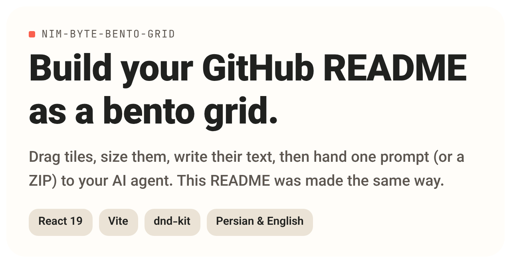<a href="https://nim-byte-bento-grid.vercel.app/">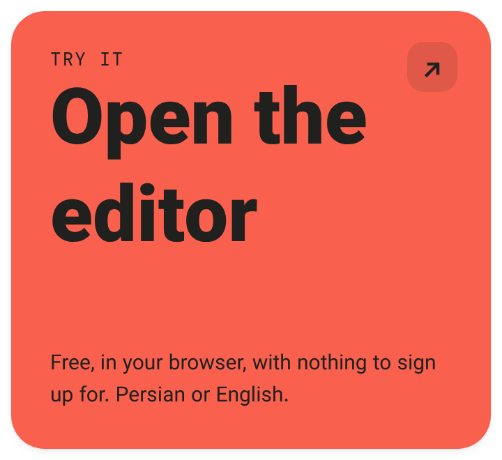</a><br/><a href="https://nim-byte-bento-grid.vercel.app/#workspace">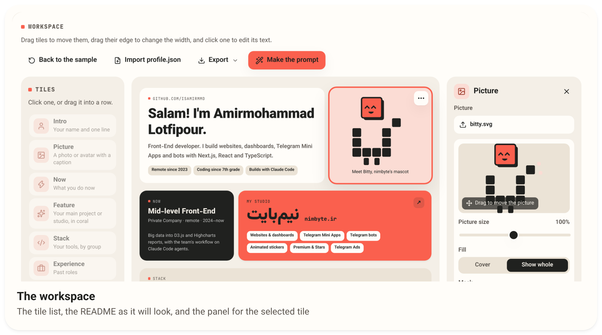</a><br/>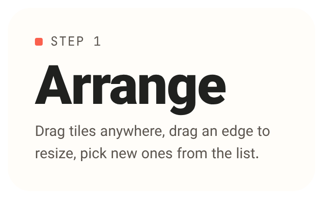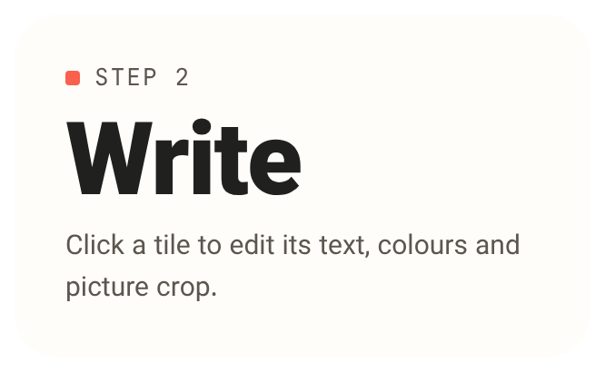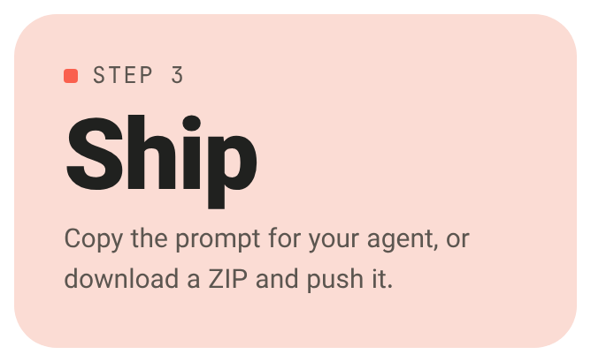<br/>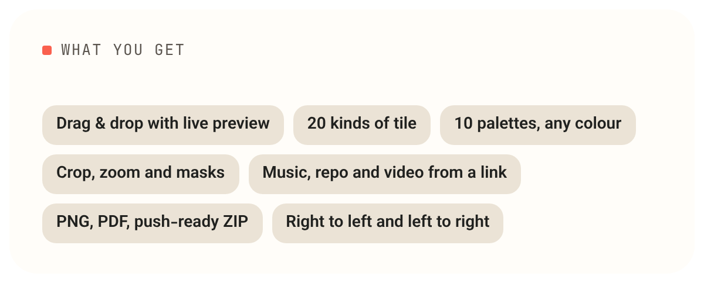<a href="https://github.com/IsAmirMmd/nim-byte-readme-maker">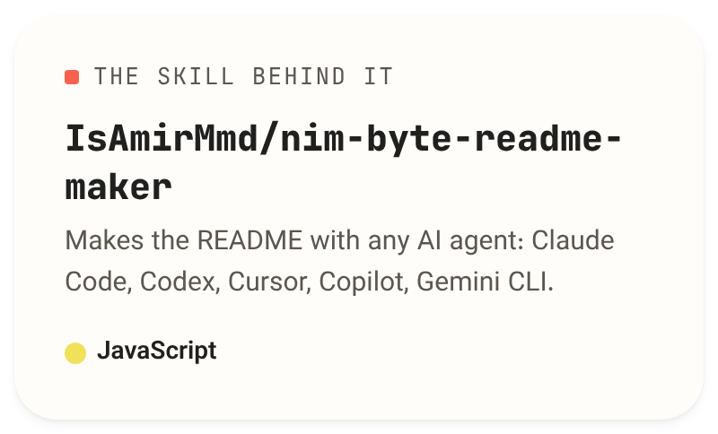</a><br/>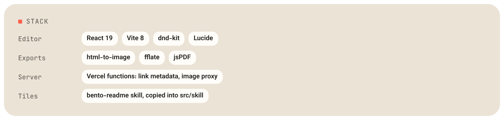<br/><picture><source media="(prefers-color-scheme: dark)" srcset="assets/bento/v2/note-1-dark.png"/>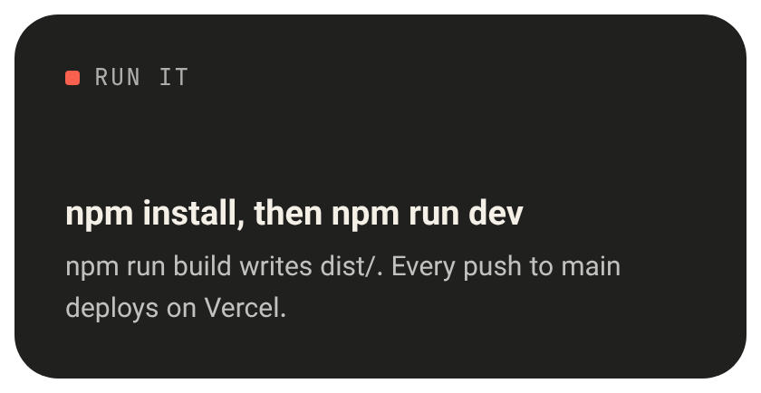</picture>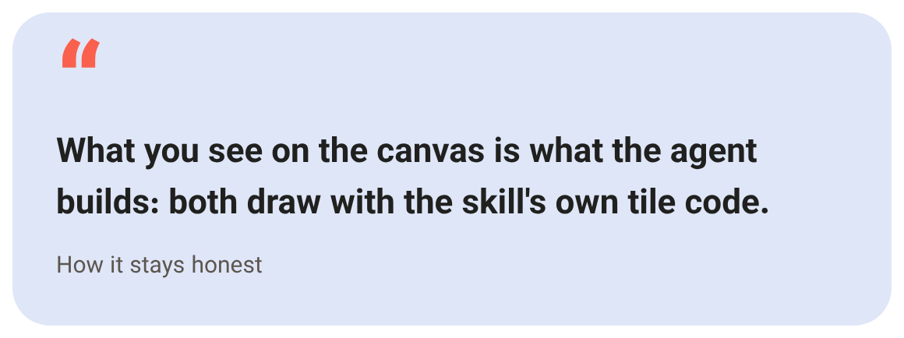<br/><a href="https://nim-byte-bento-grid.vercel.app/">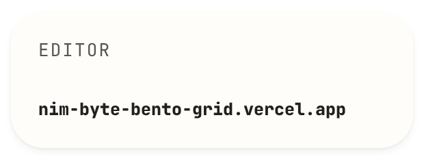</a><a href="https://github.com/IsAmirMmd/nim-byte-readme-maker">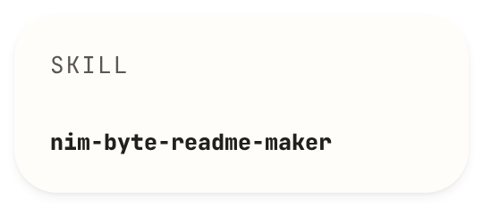</a><a href="https://nimbyte.ir">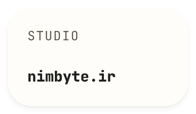</a><a href="https://github.com/IsAmirMmd">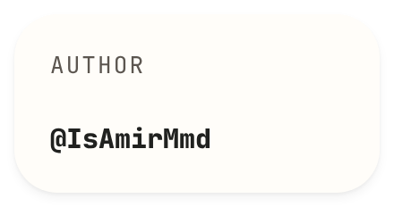</a></p>
<!-- bento:end -->

## Run it

```bash
npm install
```
```bash
npm run dev
```

`npm run build` writes `dist/`; every push to `main` deploys on Vercel.

## This README

It's a bento grid made with the [bento-readme skill](https://github.com/IsAmirMmd/nim-byte-readme-maker), from
`.bento/profile.json` (the screenshot is `.bento/images/workspace.png`). To change it, edit the profile (or open it in
the editor with *Import profile.json*), then:

```bash
node <path-to-the-skill>/skills/bento-readme/scripts/init.mjs .
```
```bash
node .bento/scripts/build.mjs
```

Fonts: [Vazirmatn](https://github.com/rastikerdar/vazirmatn) and [JetBrains Mono](https://github.com/JetBrains/JetBrainsMono)
(SIL Open Font License 1.1). Icons: [Lucide](https://lucide.dev).
